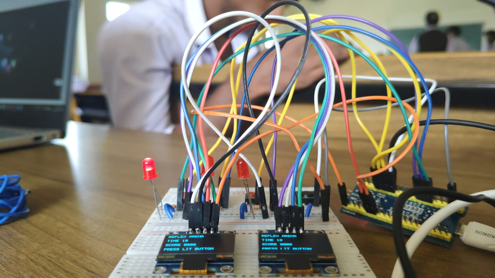
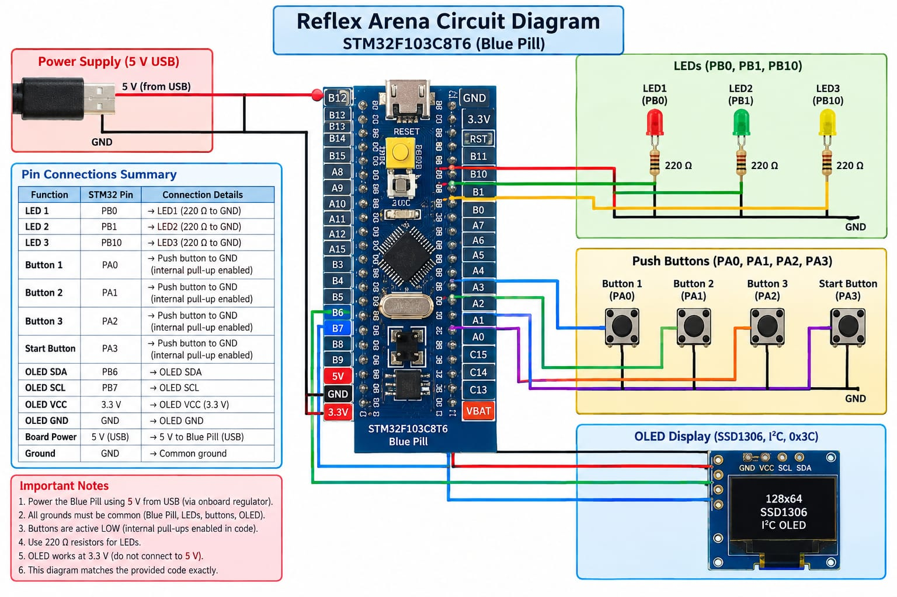
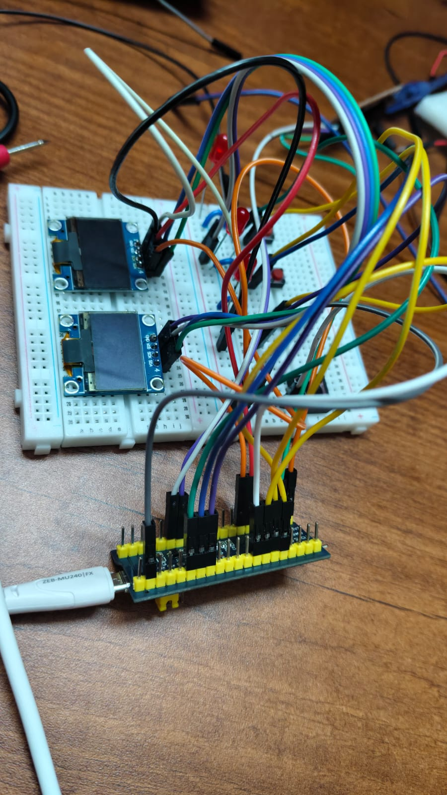
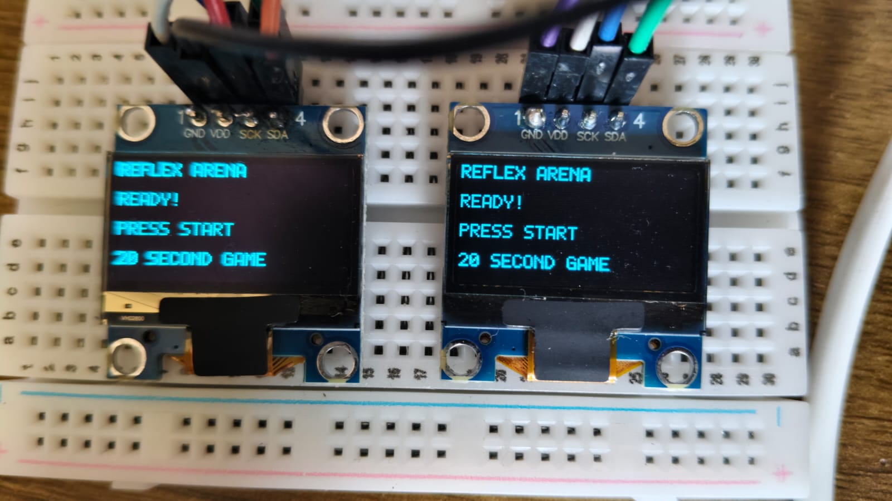

# 🎮 Reflex Arena
### ARM-Based Reaction Time Game

Reflex Arena is an interactive reaction-time game built using the **STM32F103C8T6 Blue Pill microcontroller (ARM Cortex-M3)**. The game challenges players to respond to randomly generated LED targets within a 20-second session.

Developed using Embedded C and direct register programming, the project demonstrates low-level microcontroller control, interrupt-driven timing, GPIO interfacing, software I²C communication, and OLED display integration.

---

## 📸 Project Gallery

### Hardware Prototype


### Circuit Diagram


### OLED Display


---

## ✨ Features

- 20-second reaction-time gameplay
- Three LED targets for visual feedback
- Three player input buttons
- Dedicated start button
- Random LED target generation using a Xorshift-based pseudo-random algorithm
- Interrupt-driven timing using SysTick
- Button debouncing for reliable input detection
- Score tracking based on correct button responses
- OLED-based game interface
- High-score tracking during the current power session
- Bare-metal Embedded C implementation using direct register access

---

## 🛠️ Hardware Components

| Component | Description |
|---|---|
| STM32F103C8T6 Blue Pill | ARM Cortex-M3 microcontroller |
| SSD1306 OLED Display | 128 × 64 pixel display |
| LEDs | Three visual target indicators |
| Push Buttons | Three player input buttons and one start button |
| 220 Ω Resistors | LED current limiting |
| Breadboard | Circuit prototyping |
| Jumper Wires | Hardware interconnections |
| USB Power Supply | Powers the development board |

---

## 🔌 Pin Configuration

| Function | STM32 Pin |
|---|---|
| LED 1 | PB0 |
| LED 2 | PB1 |
| LED 3 | PB10 |
| Player Button 1 | PA0 |
| Player Button 2 | PA1 |
| Player Button 3 | PA2 |
| Start Button | PA3 |
| OLED SDA | PB6 |
| OLED SCL | PB7 |

The push buttons use active-low logic with internal pull-up configuration.

---

## ⚙️ Working Principle

1. The system initializes the GPIO pins, SysTick timer, and OLED display.
2. The OLED displays the game-ready screen.
3. The user presses the start button.
4. A `READY – SET – GO` countdown sequence begins.
5. Random LED target patterns are generated and displayed.
6. Players press the corresponding buttons when their target LEDs are active.
7. Correct button responses increase the score.
8. The game runs for 20 seconds.
9. At the end of the session, the final score and high score are displayed.

---

## 💻 Software and Technologies

- **Programming Language:** Embedded C
- **Microcontroller:** STM32F103C8T6
- **Processor Architecture:** ARM Cortex-M3
- **GPIO:** Direct register configuration
- **Timer:** SysTick interrupt
- **Display Communication:** Software I²C
- **Display Driver:** SSD1306
- **Development Approach:** Bare-metal programming

The project uses memory-mapped hardware registers without HAL or CMSIS device headers.

---

## 📂 Repository Structure

```text
Reflex-Arena/
├── README.md
├── src/
│   └── main.c
├── circuit/
│   └── circuit-diagram.png
├── images/
│   ├── hardware-overview.jpg
│   ├── oled-gameplay.jpg
│   └── circuit-diagram.png
├── docs/
│   └── project-report.pdf
└── LICENSE
```

---

## 🚀 Future Improvements

- Add reaction-time measurement in milliseconds
- Implement individual player statistics
- Add sound feedback using a buzzer
- Improve hardware layout and wiring organization
- Add persistent high-score storage
- Develop a more advanced OLED game interface

---

## 👥 Project Team

- Harshil Thomas Shilly
- Agnel Varghese
- Sannya Francis MS
- Abishek M Vyas

B.Tech Electronics and Communication Engineering  
Albertian Institute of Science and Technology (AISAT), Kalamassery

---

## 📜 License

This project is intended for educational and academic purposes.


## 📸 Project Gallery

### Project Overview


### Circuit Diagram


### Hardware Wiring


### OLED Display Output


